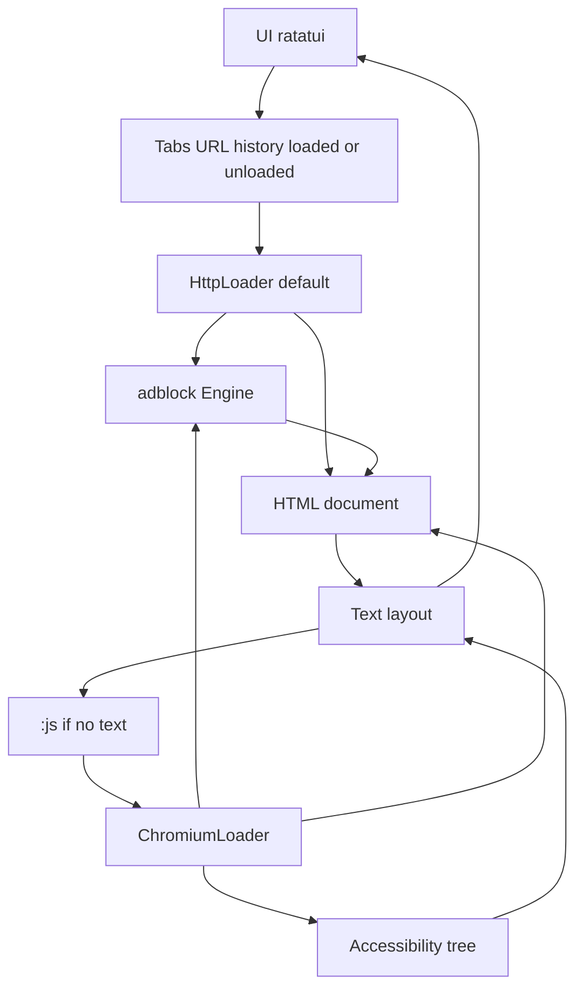

# TUI text browser

Empty repo at `/home/w0lv3/Projects/personal/tbw`. Ship a keyboard-driven text browser named `tbw`. It fetches real pages, lays out readable HTML, and runs [Brave’s `adblock` crate](https://github.com/brave/adblock-rust) (MPL-2.0) in-process. No JavaScript engine and no pixel framebuffer. Client-rendered sites stay blank; that is an accepted limit, not a bug to paper over.

Closest prior art, used as a map only (do not vendor their code): [glyph](https://github.com/k1y0miiii/glyph) (Rust, ratatui, no JS, no adblock) and [Chawan](https://chawan.net/) (full small engine, Nim, years of work). Carbonyl-style Chromium-in-a-terminal is out of scope.

## Pipeline



One binary, one crate. Modules, not a workspace: `ui`, `tabs`, `load`, `block`, `dom`, `layout`.

`Loader` returns a final URL plus a body. In the first four milestones the body is HTML, whether it came from `reqwest` or, later, from a Chromium snapshot. Live interaction adds a second body, Chrome’s accessibility tree, and a second layout path for it. Tabs never talk to `reqwest` or Chrome. A tab body is loaded or unloaded: unloading drops the document and any Chromium target, and keeps the URL and history. `tab_ttl`, `:unload`, and `:unloadothers` are that transition. The last closed target exits the Chrome process.

- **UI.** `ratatui` + `crossterm`. Tab strip, URL line, viewport, status line.
- **Load.** v1 is `reqwest` with rustls. Decode bytes with `encoding_rs` from `Content-Type` or a `<meta charset>` before parse. `html5ever` is UTF-8 only. The rest of the app sees HTML, not the HTTP client.
- **DOM.** `scraper` (wraps Servo `html5ever` + `selectors`).
- **Layout.** Our own block flow: headings, paragraphs, lists, links, simple tables, preformatted text. `unicode-width` for cell columns. Images are a placeholder node (`alt` text, source URL). That node is the Kitty hook; v1 never paints it.
- **Block.** `adblock::Engine`. Rules are immutable after build; list updates replace the whole engine. Persist the compiled engine with `Engine`’s `.dat` format under the XDG data dir (`directories` crate) so startup does not reparse EasyList every launch.

## Adblocker

Query every request we actually issue, including each redirect hop (`reqwest`’s default redirect follower is not used; we follow hops ourselves so a tracker redirect can be dropped):

```rust
let request = adblock::request::Request::new(url, source_url, "document", "GET")?;
let result = engine.check_network_request(&request);
if result.should_block() { /* do not fetch */ }
```

Request types we will use: `document` for the page, `stylesheet` when a linked sheet is fetched, `image` only once images exist. Subresources we never fetch (scripts, pixels, iframes) are simply not requested.

After parse, before layout, call `Engine::url_cosmetic_resources`. Drop elements matching `hide_selectors` via `scraper`’s selector API, then remove `script`, `style`, `noscript`, `iframe`, and `svg`. Skip selectors that fail to parse. That covers normal `##` rules.

Explicitly not in v1, because they need a JS engine or a procedural interpreter:

- `injected_script` and `##+js(...)` scriptlets
- `procedural_actions` (`:has-text`, `:upward`, and the rest of uBO’s non-CSS syntax)
- `$redirect` / resource replacements (`Engine::use_resources`)
- Brave Standard vs Aggressive first-party policy. v1 blocks whatever the loaded lists match, including first-party. The catalog marks Brave’s default components with `first_party_protections: true`.

Lists, downloaded at runtime, not committed (EasyList’s terms want attribution, and the files are huge). Default set is the two Brave components that are on for every desktop user, from [adblock-resources `list_catalog.json](https://github.com/brave/adblock-resources/blob/master/filter_lists/list_catalog.json)`:

- **Brave Default Adblock Filters** — uBlock Origin filters (including the yearly `filters-2020` … `filters-2026` slices), EasyList, URLhaus, Brave unbreak / specific / social. Skip the Android-only source.
- **Brave Default Privacy Filters** — EasyPrivacy and uBlock privacy.

Cookie and annoyance lists stay off until asked. A `:lists` command shows titles and last update time. Rebuild the engine off the UI thread; the status line says `updating filters` while that runs. Memory cost of this set is tens of MB, which is fine.

## Tabs and keys

Each tab owns a URL, a back/forward stack, a title, and a scroll offset. The page body is either loaded or unloaded. Unloading drops the document and, when this tab has a Chromium target, closes that target. The URL and history stay, so the tab is still in the strip. Focusing an unloaded tab loads it again. Switching between loaded tabs does not refetch.

A setting `tab_ttl` (minutes, `0` off) unloads a tab that has stayed in the background that long. The clock starts when the tab loses focus. The current tab never expires while you are reading it.

- `:unload` drops the current tab’s body
- `:unloadothers` drops every tab except the one you are on

When the last Chromium target closes, the browser process exits too. The session falls back to the text-browser footprint. The next JavaScript page pays a cold start of about two seconds. Scroll offset is kept and reapplied after reload; a client-rendered page may not land on the same pixel. Form text typed into Chrome is gone.

- `o` open URL or search (one configurable `{q}` template, DuckDuckGo HTML as the default because it returns real HTML)
- `t` / `W` new / close tab, `]` / `[` and `Ctrl+Tab` switch, `1`–`9` jump
- `j`/`k`, `PgUp`/`PgDn`, `g`/`G` scroll
- `Tab` move between links, `Enter` follow, `f` hint labels, `F` hint into a new tab
- `Backspace` / `b` back, `r` reload, `q` quit
- Status: title, load error, requests blocked, elements hidden. An unloaded tab shows its URL and `unloaded`.

Mouse: click a tab or a link if it falls out of the keyboard path cheaply. Do not design a mouse-first UI.

## Milestones

1. **One page.** Fetch, decode, parse, lay out, draw, behind a `Loader` that returns HTML plus the final URL. Open a URL, scroll, follow a link, go back. Fixture HTML tests for headings, links, and wrapping. Manual check against `example.org`, a Wikipedia article, and Rust docs.
2. **Tabs.** Tab strip, independent history, and a loaded/unloaded body. `:unload`, `:unloadothers`, and `tab_ttl`. Session is in memory only.
3. **Adblock.** List download, `.dat` cache, network checks on document and stylesheet requests, cosmetic node removal, status counts. Unit tests use a tiny inline list (`||evil.test^` and `example.com##.ad`), not the full EasyList. One fixture page proves an ad node disappears and a normal paragraph stays.
4. **Find-in-page, and plain HTML forms.** A cookie jar and GET/POST forms for sites that work without JavaScript. Keep this thin: Chromium already owns cookies, redirects, and forms, so a deep HTTP session layer gets thrown away on the pivot below.

## Tasks

Build these in order. Chromium, Kitty, and bookmarks are not in this list.

1. **Scaffold.** One crate, binary `tbw`, modules `ui`, `tabs`, `load`, `block`, `dom`, `layout`. `Loader` returns the final URL and an HTML body. `block` is an empty pass. Done when the process draws a blank terminal UI and `q` quits.
2. **HttpLoader.** `reqwest` with rustls. Decode with `encoding_rs`. Follow redirects in our code, with a hop cap. Done when a load returns the HTML and the URL after redirects.
3. **Layout.** `scraper` parse. Drop `script`, `style`, `noscript`, `iframe`, and `svg`. Lay out headings, paragraphs, lists, links, preformatted text, and simple tables. Images are an alt-text placeholder. Fixture tests cover headings, links, and wrapping.
4. **Browse one page.** Viewport scroll, move between links, Enter follows, back, `r` reload, `o` opens a URL. A layout with no text says so on the status line. Check `example.org`, a Wikipedia article, and Rust docs by hand.
5. **Tabs.** Each tab has its own URL, history, and scroll. Tab strip. `t` / `W`, `]` / `[`, `Ctrl+Tab`, `1`–`9`. `o` searches through one `{q}` template, DuckDuckGo HTML. A new tab uses `HttpLoader`. Switching loaded tabs does not refetch.
6. **Unload.** Body is loaded or unloaded. `:` enters a command. `:unload` and `:unloadothers`. `tab_ttl` in minutes, `0` off, clock starts on blur, the current tab never expires. Focusing an unloaded tab loads its URL again and reapplies the saved scroll offset.
7. **Adblock core.** `check_network_request` on the document and on every redirect hop. Cosmetic `hide_selectors` drop matching nodes; a selector that fails to parse is skipped. Status shows blocked requests and hidden elements. Tests use `||evil.test^` and `example.com##.ad`, and a fixture page keeps a normal paragraph.
8. **Filter lists.** Download Brave Default Adblock Filters and Brave Default Privacy Filters. Skip the Android-only source. Compile to a `.dat` under the XDG data dir and load that on the next start. Rebuild off the UI thread. `:lists` shows titles and the last update.
9. **Find and forms.** `/` finds text in the page, `n` / `N` move between hits. A cookie jar and GET/POST fields are enough for sites that work without JavaScript. No password store and no deeper session layer.

Later, only if empty app shells are actually in the way: `:js` and a read-only `ChromiumLoader`, then the accessibility-tree interaction loop. `auto_js`, Kitty images, and bookmarks wait behind those.

## Chromium pivot

Chrome is not the default loader. Every navigation starts on `HttpLoader`. A tab moves to `ChromiumLoader` only when that page needs JavaScript. The memory difference is the whole Chrome process: docs and articles stay in the 50–150 MB text browser, and a Wikipedia tab never starts a renderer. Running Chrome for every page would spend 150–300 MB before the first site, plus a renderer per tab, to draw pages `reqwest` already returned.

The check is a command, not a classifier. After a load whose layout has no text, the status line says the page had no text content and mentions `:js`. `:js` reloads this tab’s URL through Chromium. A short real page, such as a one-line note, stays on HTTP because the user did not ask. An `auto_js` setting can press that button itself when the body is an empty shell; it is a follow-up, and it still does not try to guess from scripts or frameworks. Following a link inside a Chromium tab stays on Chromium for that tab. A new tab goes back to HTTP.

This is how `<div id="app">` gets text later. It is a second `Loader`, not a framebuffer browser. [chromiumoxide](https://docs.rs/chromiumoxide) drives a normal Chromium or Chrome already on `PATH` over the DevTools Protocol. One browser process, one target per tab. Navigate, wait until the DOM stops changing (a heuristic: network quiet plus a short mutation pause, with a timeout), then `page.content()` and hand that HTML to the existing DOM and layout path. Links that are real `<a href>` keep working. The TUI never draws Chromium’s pixels. Carbonyl stays out.

Adblock moves to the same engine with a different hook. CDP `Fetch.requestPaused` calls `check_network_request` for every subresource Chromium wants (scripts, XHR, images) and then continues or fails the request. Cosmetic rules are injected as a stylesheet in the page so Chromium hides those nodes before the snapshot. Scriptlets become possible here, because a JS engine finally exists; they are not part of the first Chromium cut.

Two levels, with very different cost:

- **Read-only snapshot.** Fills client-rendered articles, docs, and dashboards that paint once. About one milestone on top of a working text browser: a few days to prove `page.content()` on one SPA, one to two weeks to make settle, timeout, crash restart, and adblock interception reliable. Extra cost the user feels: Chromium must be installed, and one browser is roughly 150–400 MB of RAM. Some sites refuse headless Chrome no matter what we do.
- **Live interaction.** Same settle-and-snapshot helper as the read-only load. The document becomes Chrome’s accessibility tree (`Accessibility.getFullAXTree`) instead of raw HTML: each node already has a role and a name (link, button, text box, heading, text). Focus moves over those nodes. Enter resolves the node and calls `click()` in the page. Typing focuses the node and inserts text with `Input.insertText`. Scrolling past the snapshot forwards a wheel event, which is what makes infinite scroll and virtualized lists work. The URL bar follows `Page.frameNavigated`. After every action, call `settle()` again and replace the tree. That is one loop, about another milestone after snapshots, not a second browser. Hover menus, canvas, drag-and-drop, and rich text editing stay unsupported. Do not map terminal cells onto Chrome’s pixels.

Build the `Loader` trait in milestone 1 so this stays a new file. Do not add Chromium to the first four milestones.

## Memory

The text browser and the filter engine stay small. Chromium is a separate process and starts only when a tab needs JavaScript.

- **Text browser, no Chrome.** The binary, a compiled Brave list set, and a handful of article tabs should sit around 50–150 MB. Idle CPU is about zero. A tab is the HTML plus the laid-out lines, a few megabytes, and it can be dropped without killing a renderer.
- **Chrome running.** One shared browser, not one Chrome per tab. A live headless browser with a blank page is on the order of 150–300 MB. Each open site adds a renderer: about 15–80 MB proportional for a Wikipedia-class page, about 50–180 MB for a feed or news site, and about 120–400 MB for a web app such as Gmail or Docs. Five mixed tabs is commonly 0.5–1.5 GB. Headless does not remove that cost; the GUI is the small part. Ad blocking lowers it by never letting ad frames start.
- **Background tabs.** A target we keep alive keeps its renderer. `:unloadothers`, `:unload`, and `tab_ttl` close those targets and keep the URL. With no targets left, Chrome exits. CPU while idle should be near zero if timers are not running; a page load uses about one core for a short spike.

These are ranges from public headless and desktop Chrome measurements (2026), not a benchmark of this program. RSS double-counts memory shared between Chrome processes, so a process-list total looks worse than the RAM actually added.

## Risks

- Cosmetic selectors from the lists include syntax `selectors` rejects. Ignore those lines; never fail the page.
- Rebuilding the engine from list text takes seconds. The `.dat` cache is what makes the second launch feel instant. A version mismatch in the `.dat` header means “recompile from list text,” which the crate already signals.
- Stylesheets are optional for v1 layout (a small user-agent style for `h1`–`h6`, `a`, `pre`, `code` is enough). Fetching author CSS can wait until color and `display:none` from the page itself matter. Cosmetic hiding does not need author CSS.
- A large share of the modern web is an empty `<div id="app">` until JavaScript runs. v1’s status line says the page had no text content. A Chromium snapshot fills that through the same HTML layout. Live interaction adds an accessibility-tree body beside it. Tabs, the filter engine, and unload stay as they are.